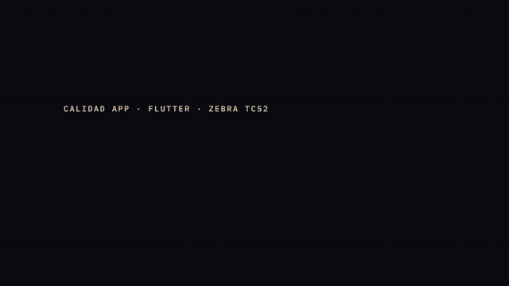
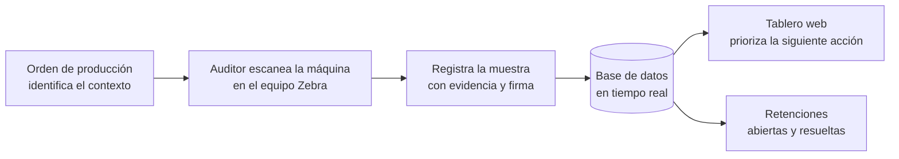
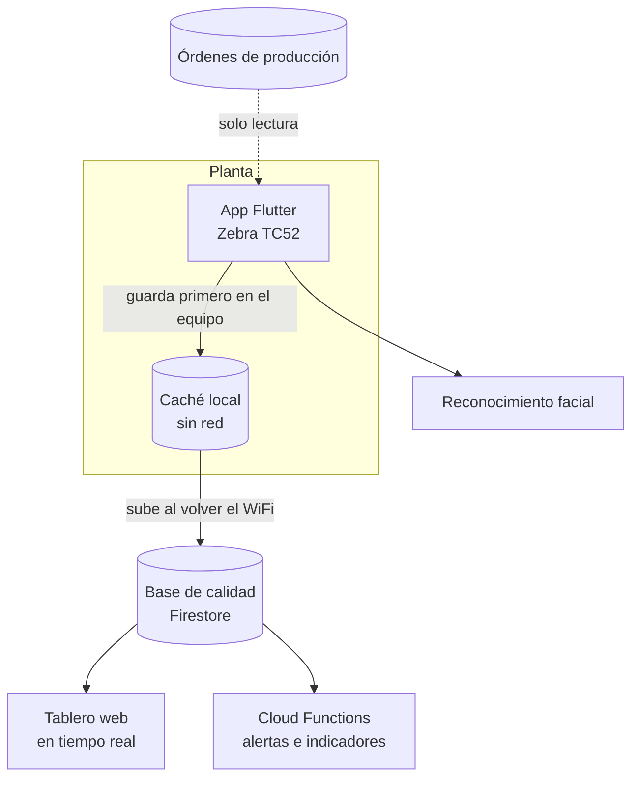
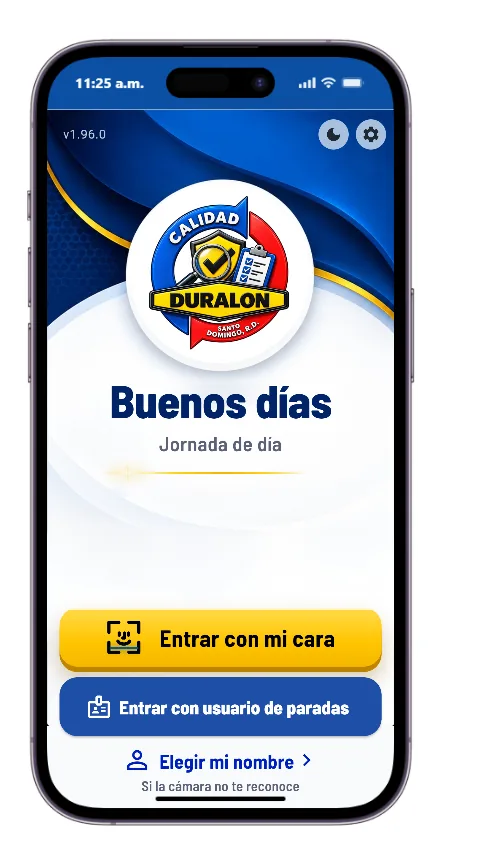
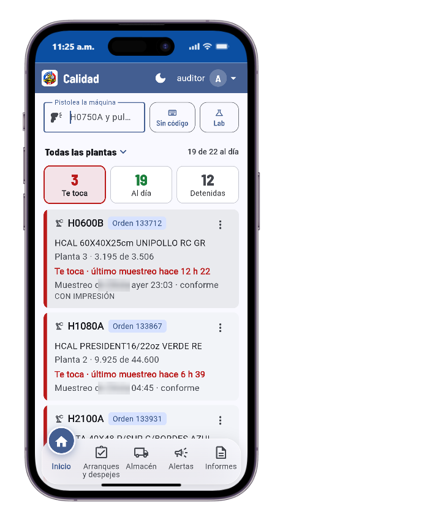
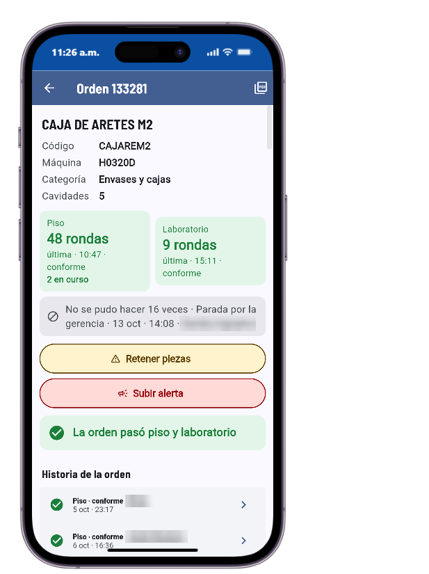
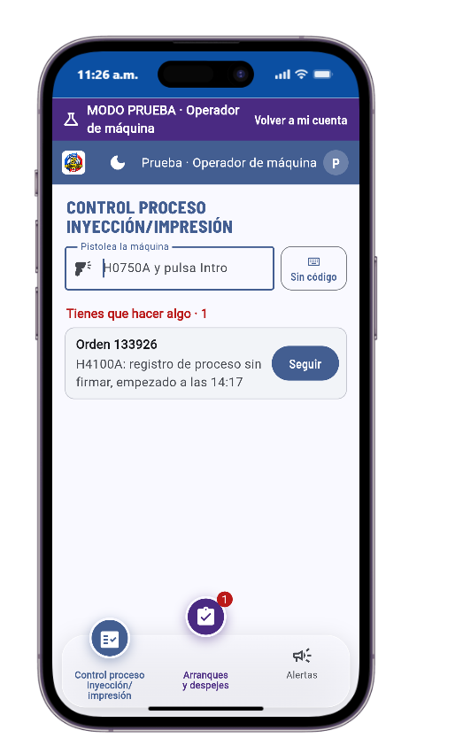
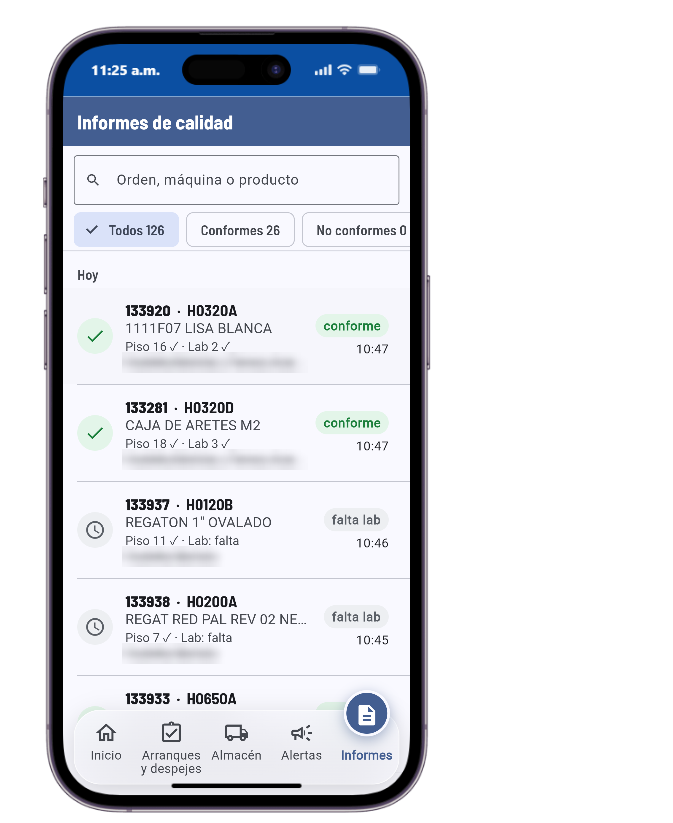

# Calidad App · Caso de estudio

> **Este repositorio es un caso de estudio, no contiene código.** El sistema es propiedad de la empresa donde está en producción y su código permanece privado. Aquí se muestra el problema, la solución, cómo funciona y los resultados.
>
> 🎬 Recorrido en video y más proyectos: **[portafolio de Yeison Rojas](https://ai-automation-portfolio-cyan.vercel.app)**

Digitaliza el control de calidad de una planta de inyección: reemplaza las hojas de papel por muestreos trazables desde equipos Zebra y un tablero web en tiempo real.

*Recorrido real de la app; los nombres y datos internos están ocultos.*

## El reto

Las pruebas de calidad se anotaban en papel. No había trazabilidad de orden, máquina, auditor ni hora, y el equipo de calidad no sabía qué máquina le tocaba revisar a continuación.

## La solución

Cada muestreo queda ligado a la orden, el producto, la máquina y el auditor. Un plan diario prioriza lo que toca revisar, oculta las máquinas detenidas y permite responder a las desviaciones con evidencia.

- **App Android para equipos Zebra:** el auditor escanea la máquina y registra el muestreo en el piso.
- **Acceso con reconocimiento facial:** cada registro queda firmado por quien lo hizo.
- **Rondas de piso y laboratorio** por orden, con control del proceso de inyección e impresión.
- **Retenciones con evidencia:** las desviaciones se abren, se siguen y se cierran con fotos y firma.
- **Tablero web en tiempo real** para el seguimiento de calidad.

## Cómo funciona

## Resultados (septiembre – octubre 2026)

| Indicador | Resultado |
|---|---|
| Muestreos digitales | **2,724** en poco más de un mes |
| Uso semanal | **×25**, de 72 a 1,837 muestreos |
| Trazabilidad | **38 máquinas** y **168 órdenes** |
| Retenciones | **12** abiertas y resueltas con evidencia |

## Arquitectura

## Decisiones técnicas

- **Funciona sin red.** En la nave la señal se cae: todo se guarda en el equipo y sube solo cuando vuelve el WiFi. Si producción no responde en 8 segundos, el auditor sigue a mano y la prueba queda marcada como *no verificada*; la jornada no se detiene porque otro sistema esté caído.
- **Se guarda al empezar, no al cerrar.** Una prueba puede durar media hora; si el equipo se queda sin batería, consta que la ronda se empezó y a qué hora.
- **Nunca escribe en la base de producción.** Lee las órdenes en un solo sentido y guarda todo en su propia base: un cambio del otro lado puede romper una lectura (y se nota), pero nunca corromper sus datos.
- **No se inventan datos.** Una ronda que nadie firmó a tiempo queda como *no terminada*; no se cierra después de memoria.
- **Capas solo donde hay lógica de verdad.** Las reglas del negocio (qué ronda toca, a qué jornada pertenece, si la versión está vieja) son funciones puras sin Firebase, y por eso tienen pruebas automatizadas.

## Mi rol

Creador y arquitecto del sistema. Diseñé y desarrollé de punta a punta la solución móvil y web: flujo de muestreo, trazabilidad, reconocimiento facial, alertas e indicadores.

## Stack

Flutter (Android en Zebra TC52 y web) · Firebase (Firestore, Auth, Cloud Functions, Hosting) · Reconocimiento facial

## Capturas

  
  
  
  
  

*Capturas del sistema real; los nombres de personas están difuminados.*

---

## English summary

**Calidad App** digitizes quality control for an injection-molding plant. Paper sheets were replaced by traceable samples captured on Zebra devices and a real-time web dashboard. Every sample is linked to the order, product, machine and auditor, and a daily plan tells the quality team which machine to check next.

**Results (Sep–Oct 2026):** 2,724 digital samples, 25× weekly usage growth (72 → 1,837), 38 machines and 168 orders traced, 12 quality holds opened and closed with evidence.

**Key engineering decisions:**
- Offline-first: everything is stored on the device and synced when WiFi returns.
- Saved on start, not on close, so an interrupted test is still on record.
- Read-only bridge to the production database: it can never corrupt another system's data.
- Pure, tested domain rules with no Firebase imports.

**My role:** creator and architect of the system. End-to-end design and development of the mobile and web solution: sampling flow, traceability, face recognition, alerts and KPIs.
**Stack:** Flutter (Android on Zebra TC52 and web), Firebase (Firestore, Auth, Cloud Functions, Hosting).

*This is a case study. The source code belongs to the company and stays private.*
